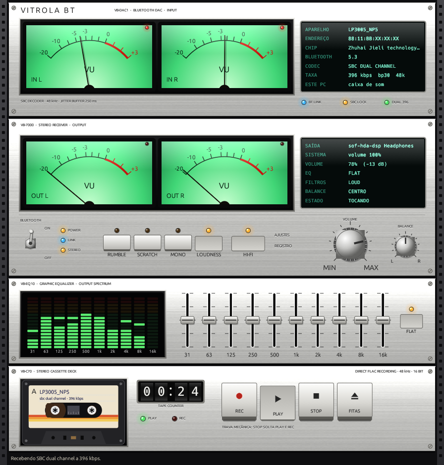

<p align="center"></p>

# vitrola-bt

[](https://github.com/4snt/vitrola-bt/actions/workflows/ci.yml)

Ouça e grave no Linux o áudio Bluetooth de uma **vitrola**. O PC se passa por
**caixa de som Bluetooth**, a vitrola pareia nele, o disco toca nos alto-falantes
do PC — ou vira um FLAC — e tudo aparece num **sistema hi-fi de rack** dos anos 70/80:
DAC Bluetooth, receiver, equalizador gráfico e tape deck, com VU verdes iluminados.



Testado com a Polyvox XTD-67 (chip JieLi, aparece como `LP3005_NP5`) em
Pop!_OS 24.04 / COSMIC · PipeWire 1.6 · WirePlumber 0.5 · BlueZ 5.72.

## O que ele faz

- **Receptor Bluetooth próprio, no máximo que o chip aceita.** Sozinha, a vitrola
  escolhe SBC *joint stereo* a ~219 kbps. O app força **SBC dual channel a ~396 kbps**
  (o mesmo bitpool, só que por canal), dentro do que o próprio chip anuncia.
- **O rack:**
  - **VB-DAC1 (Bluetooth DAC):** VU de **entrada** (o que chega da vitrola) e display com
    aparelho, endereço, chip, versão do Bluetooth, codec, bitpool e taxa.
  - **VB-7000 (receiver):** VU de **saída** (depois do EQ, filtros e volume) com lâmpada
    PEAK e uma segunda tela com o que sai (dispositivo e volume do sistema, volume, EQ,
    filtros, balance, estado); embaixo, **VOLUME**, **BALANCE**, alavanca BLUETOOTH,
    funções e o botão **HI-FI**.
  - **VB-EQ10 (equalizador):** analisador de espectro da **saída** e os 10 cursores.
  - **VB-C70 (tape deck):** fita com carretéis girando, contador e teclas de piano.
  - O rack ocupa toda a largura da janela e rola na vertical quando ela é baixa. Os VU
    podem ser verdes, azul clássico ou âmbar (em AJUSTES).
- **HI-FI:** renegocia o SBC dual channel (~396 kbps) na hora; a lâmpada acende quando
  ele está ativo. Sem apertar nada, o app tenta o dual a cada minuto com o link estável.
- **Equalizador gráfico de 10 bandas** (31 Hz a 16 kHz, ±12 dB) e as funções de um
  receiver de vinil: **RUMBLE** (corta o ronco do motor abaixo de ~35 Hz), **SCRATCH**
  (atenua chiado e estalos acima de ~8 kHz), **MONO** (discos mono antigos com menos
  ruído de sulco), **LOUDNESS** (graves e agudos para ouvir baixo) e **BALANCE**. Tudo
  só na escuta: o **REC grava o sinal original**, sem processamento.
- **Teclas com trava mecânica:** PLAY e REC travam embaixo, STOP solta as duas.
  **REC** grava FLAC sem perdas em `~/Música/Vitrola`; **FITAS** abre a pasta.
- **Alavanca BLUETOOTH:** liga e desliga o receptor. Desligada, a vitrola não toca.
- **Conexão automática:** chegou som, toca na hora no modo que a vitrola escolher; com
  o link estável há 20 s, o app tenta o dual channel e volta para joint stereo se ele
  travar. Sem a vitrola, o PC fica visível e a chama a cada 20 s (só o perfil certo);
  se o sistema conectar o áudio ao contrário (PC → vitrola), o app corrige. Um
  **guardião único** faz uma operação de conexão por vez, e um **cão de guarda** pede
  o fluxo de novo se a vitrola parar de mandar pacotes.
- **Uma janela só** (abrir de novo traz a existente para a frente), ícone na
  **bandeja** (COSMIC, KDE, XFCE, GNOME com AppIndicator) e fechamento seguro.
- **Disfarce de caixa de som sem senha:** o pacote instala uma regra do polkit que
  libera só esse ajuste para quem está logado na sessão.

## Instalar

Baixe o pacote da sua distro na [página de releases](https://github.com/4snt/vitrola-bt/releases):

| Distro | Arquivo | Instalar |
|---|---|---|
| Ubuntu 22.04+, Debian 12+, Pop!_OS, Mint | `vitrola-bt_*_amd64.deb` | `sudo apt install ./vitrola-bt_*_amd64.deb` |
| Fedora 42+ | `vitrola-bt-*.x86_64.rpm` | `sudo dnf install ./vitrola-bt-*.x86_64.rpm` |
| Arch, Manjaro, EndeavourOS | `vitrola-bt-*-x86_64.pkg.tar.zst` | `sudo pacman -U vitrola-bt-*-x86_64.pkg.tar.zst` |
| Outras | `vitrola-bt-*-linux-x86_64.tar.gz` | extraia e rode `sudo ./instalar.sh` |

Depois, reinicie o áudio da sua sessão (aplica as configs do PipeWire):

```bash
systemctl --user restart wireplumber pipewire pipewire-pulse
```

O CI instala cada pacote em Ubuntu 24.04/22.04, Debian 12, Fedora 42 e Arch antes de publicar.

## Usar

Abra **Vitrola BT** no menu de aplicativos:

1. Suba a alavanca **BLUETOOTH**.
2. Na vitrola, ligue o Bluetooth e escolha **"Vitrola PC"**.
3. O som sai nos alto-falantes. **REC** grava; **AJUSTES** e **REGISTRO** ficam no painel.

No equalizador, arraste os cursores (duplo clique zera, **FLAT** zera todos); no
**VOLUME** e no **BALANCE**, arraste para cima ou para baixo (duplo clique volta ao
padrão). Os ajustes ficam salvos. Se o display mostrar joint stereo, aperte **HI-FI**.

No terminal, o mesmo motor sem janela:

```bash
vitrola receber          # ou: vitrola-bt --sem-interface  (Ctrl+C para sair)
vitrola diagnostico      # perfis anunciados pela vitrola
```

## Como funciona

O Linux já tem o driver Bluetooth (BlueZ) e o servidor de áudio (PipeWire). O que
faltava era o PC **assumir o papel de receptor (A2DP Sink)**, **aparecer para a vitrola
como caixa de som** e **receber no melhor modo que o chip aceita**:

- **Disfarce:** a classe Bluetooth do PC vira *Audio/Video · Loudspeaker*
  (`btmgmt class 4 20`), porque transmissores de vitrola escondem computadores da busca.
- **Agente de pareamento** que aceita sozinho (Just Works ou PIN 0000) e marca a vitrola como confiável.
- **Receptor A2DP próprio** (`src/receptor.rs`), um endpoint SBC registrado no BlueZ.
  O chip JieLi ignora as capacidades anunciadas quando é ele quem configura (sempre
  *joint stereo*), então o PC abre o A2DP ou pede a reconfiguração ao endpoint dele
  e escolhe *dual channel*; se o fluxo ficar parado, o `Acquire` pede o START à vitrola.
  O SBC é decodificado pela `libsbc` do sistema e entregue ao PipeWire (`pw-cat`).
- Por isso a config do WirePlumber **tira o papel `a2dp_sink` do PipeWire**: quem
  recebe a vitrola é o app. Mandar áudio do PC para fones e caixas continua normal.

Armadilhas do BlueZ 5.72 que o app contorna:

- O `bluetoothd` **cai (segfault)** se um receptor sair do ar com um fluxo A2DP aberto.
  O app desliga na ordem segura (para o áudio, solta a vitrola, espera o BlueZ fechar o
  fluxo e só então se desregistra) e, se o serviço reiniciar, religa tudo sozinho.
- O `btmgmt` **nunca termina** quando a entrada não é um terminal; o ajudante do
  disfarce o roda num pseudo-terminal (`script`) e com timeout.

## Qualidade: o que esperar

| Modo | Bitrate | Agudos |
|---|---|---|
| SBC joint stereo (o chip escolhendo) | ~219 kbps | corte seco em ~16 kHz |
| **SBC dual channel (o app escolhendo)** | **~396 kbps** | vai até ~18 kHz |

Fica entre o Spotify "Alta" (160 kbps) e o "Muito alta" (Vorbis 320 kbps): Bluetooth
sempre comprime. A diferença que se ouve no vinil vem da masterização e do caráter da
cápsula e do pré, não da resolução.

### Qualidade máxima de verdade: cabo

Para digitalizar discos sem perdas, ligue a saída **RCA** da vitrola numa **interface de
áudio USB** com entrada de linha e grave em 24 bit / 96 kHz:

```bash
pw-record --target <nome-da-interface> --rate 96000 --format s24 --channels 2 disco.flac
```

(`wpctl status` lista os nomes.) A XTD-67 tem pré phono selecionável: em **PHONO**, a
saída RCA entrega o sinal cru da cápsula, para aplicar a curva RIAA no software.

## Desenvolvimento

```bash
cargo build --release                 # binário em target/release/vitrola-bt
cargo test && cargo clippy -- -D warnings
bin/vitrola instalar                  # instalação de desenvolvimento (menu + configs)
packaging/build.sh v0.3.0             # .deb/.rpm/.pkg.tar.zst/.tar.gz em dist/ (nfpm ou docker)
docker run --rm -v "$PWD:/src:ro" -w /src fedora:42 bash packaging/test-install.sh
git tag v0.3.0 && git push --tags     # o CI publica a release
```

Estrutura: `src/receptor.rs` (endpoint A2DP), `src/audio.rs` (thread de áudio),
`src/sbc.rs` (libsbc), `src/flac.rs` (codificador FLAC), `src/medidor.rs` (VU e FFT),
`src/dsp.rs` (equalizador e filtros), `src/saida.rs` (saída com buffer anti-jitter),
`src/desenho.rs` e `src/ui.rs` (o deck, em egui), `src/backend.rs` (alavanca,
disfarce, reconexão), `src/bandeja.rs` e `src/instancia.rs`.

**Windows:** a interface compila e abre (o CI gera uma prévia `.exe`), mas o receptor
ainda é só Linux; no Windows o caminho será a API `AudioPlaybackConnection`.

## Problemas comuns

- **A vitrola não acha o PC:** veja no display, em ESTE PC, se aparece "caixa de som,
  visível". Se aparecer "computador", o disfarce não foi aplicado (sem o pacote, ele pede senha).
- **Estalos ou cortes:** aproxime a vitrola e afaste-a do roteador 2.4 GHz.
- **Sem som com a vitrola conectada:** abra o REGISTRO e aperte PLAY.
- **Conecte pelo botão da vitrola (ou deixe o app reconectar).** O applet de Bluetooth
  do sistema pode conectar o lado "caixa de som" do chip; o app corrige, mas leva alguns segundos.

## Marcas e afiliação

Projeto independente e sem fins comerciais. **Não é afiliado, patrocinado nem endossado**
pela Polyvox, pela Zhuhai JieLi Technology nem pelo Bluetooth SIG. Polyvox, XTD-67 e
Bluetooth® são marcas de seus respectivos titulares e aparecem aqui só para indicar com
qual aparelho e qual tecnologia o software é compatível. O projeto não usa logotipos de
terceiros, não altera nem acessa o firmware da vitrola e se comunica com ela apenas pelos
perfis Bluetooth padronizados (A2DP/AVDTP), por meio do BlueZ. Os nomes de modelo do rack
(VB-DAC1, VB-7000, VB-EQ10, VB-C70) são fictícios.

## Licença

MIT. Veja [LICENSE](LICENSE) e as licenças das dependências em [THIRD_PARTY.md](THIRD_PARTY.md).
